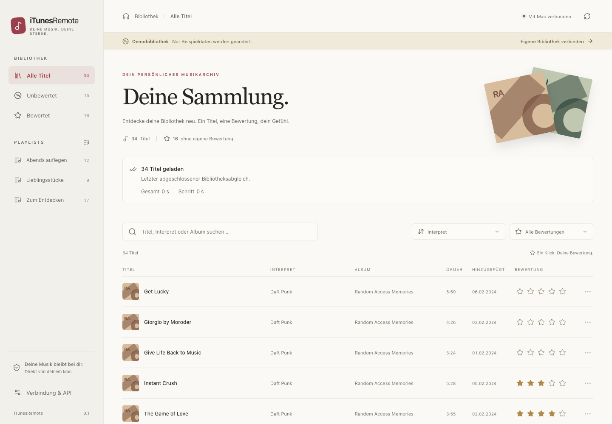
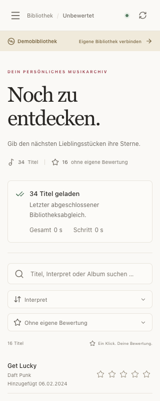

# iTunesRemote

[English](README.md) | **Deutsch**

Eine Mac-App mit Weboberfläche auf dem Mac und im lokalen Netzwerk zum Durchsuchen und Bewerten der Bibliothek von Apples Musik-App. Die versionierte REST-API ist zugleich die Grundlage für eine spätere native iPad-App.

Die App ist für den persönlichen Einsatz gedacht. Fehler und Vorschläge können als [GitHub-Issue](https://github.com/DWegmann/iTunesRemote/issues) gemeldet werden. Die Oberfläche ist derzeit deutschsprachig; die Projektdokumentation steht auf Englisch und Deutsch bereit.

> **Nichtkommerzielle Weiterverwendung:** Der ursprüngliche Projektcode darf unter der [PolyForm Noncommercial License 1.0.0](LICENSE.md) verwendet, verändert und weitergegeben werden. Diese Lizenz erlaubt keine kommerzielle Nutzung.

## Beispielansichten

Die Screenshots zeigen ausschließlich die integrierte Demobibliothek im Browser. Die schmale Ansicht ist eine Browseransicht, keine native iPad-App.





## Herkunft und Lizenz

Der ursprüngliche Projektcode wird unter der **PolyForm Noncommercial License 1.0.0** veröffentlicht, entsprechend den Projekten [Lichtblick](https://github.com/DWegmann/Lichtblick) und [Mac Spaces Wallpaper Manager](https://github.com/DWegmann/MacSpacesWallpaperManager). Maßgeblich ist der vollständige [Lizenztext](LICENSE.md). Bei Weitergabe müssen der Lizenztext oder seine URL sowie die erforderlichen Hinweise erhalten bleiben.

Required Notice: Copyright 2026 Dominic Wegmann

Die Lizenz gilt für die ursprünglichen Projektbestandteile, soweit entsprechende Rechte bestehen. Der Quellcode ist zur nichtkommerziellen Weiterverwendung öffentlich verfügbar („source available“); die kommerzielle Einschränkung entspricht keiner Open-Source-Lizenz im Sinne der OSI. Drittanbieter behalten ihre eigenen Lizenzen; deren unabhängige Rechte werden dadurch nicht eingeschränkt. Referenzen und Hinweise stehen in [THIRD_PARTY_NOTICES.md](THIRD_PARTY_NOTICES.md).

## App starten

Nach dem [Build aus dem Quellcode](#entwicklung) liegt die App unter **`dist/iTunesRemote.app`**. Doppelklick startet die Menüleisten-App und öffnet den Browser unter **`http://127.0.0.1:8765/`**. Port **8765** bleibt bei Neustarts und Updates gleich. Ist er belegt, zeigt die App einen Fehler und wechselt nicht auf eine andere Adresse. Die App enthält ihre Python-Laufzeit und die fertige Weboberfläche; eine separate Installation von Python oder Node ist zum Benutzen nicht erforderlich.

Das Repository enthält den Quellcode; lokale App-Pakete und ZIP-Dateien unter `dist/` werden nicht mit Git versioniert. Den durchgeführten Prüfstand und offene Nachweise dokumentiert [PRUEFUNG.md](PRUEFUNG.md).

1. App öffnen. Standardmäßig prüft sie Bibliothekszugriff und Automation für Musik, bevor sie den Browser öffnet. Nach dem einmaligen Erlauben sollen Updates mit derselben Signaturidentität die Freigaben weiterverwenden.
2. Die macOS-Dialoge für **Medien & Apple Music** und **Automation für Musik** beantworten.
3. Die Weboberfläche öffnet sich, sobald der Hintergrundimport gestartet ist. Ein vorhandener Bibliotheksstand lässt sich sofort durchsuchen, filtern und sortieren. Ohne gespeicherten Stand erscheinen die Titel nach dem ersten vollständigen Import. Die Mac-App zeigt Einlesen, Vorbereitung, Bewertungsabgleich, Indexaufbau und Speichern getrennt an. Sie gleicht die Anzeige alle zwei Sekunden mit dem Dienst ab, sodass eine ausgebliebene Abschlussmeldung die Anzeige nicht dauerhaft offen hält. Die Weboberfläche zeigt den laufenden Abgleich an.
4. Einen Stern anklicken. „Gespeichert“ erscheint erst nach dem Rücklesen aus der Musik-App.

Die Freigaben können je nach macOS dem Host oder dem gebündelten Hilfsprozess zugeordnet werden. Bei einer verweigerten Freigabe zeigt die Oberfläche den nötigen Einstellungsbereich an. Im Browser mit dem **Webpasswort** aus der Mac-App anmelden. Eine gültige Browsersitzung bleibt beim Neuladen erhalten.

### Dauerhaftes Webpasswort

Beim ersten Start wird automatisch ein zufälliges Webpasswort mit 24 Zeichen erzeugt. Im App-Fenster unter **Webpasswort** lässt es sich anzeigen oder kopieren; im Menüleisten-Menü gibt es **Webpasswort kopieren**. Der Browser fragt nach diesem Passwort. Unter **Verbindung & API → Abmelden** lässt sich die aktuelle Browsersitzung beenden.

Das Passwort bleibt bei Dienstneustarts und App-Updates gleich. Es liegt zusammen mit Sitzungen und Gerätezugängen in `~/Library/Application Support/iTunesRemote/auth.sqlite3`, außerhalb des App-Pakets. Der Datenordner hat Benutzerrechte `0700`, die Datenbank `0600`. Nur der interne Mac-Host darf das Passwort über die API abrufen; angemeldete Browser und native Geräte erhalten es nicht. Das Passwort wird weder in URLs noch in Protokolle geschrieben.

Die Browsersitzung gilt zwölf Stunden. Nach Ablauf erneut dasselbe Passwort eingeben. Bestehende Sitzungen und Gerätezugänge bleiben bei der Einführung der Passwortanmeldung erhalten. Wird der Datenordner gelöscht oder ein anderer Datenordner gewählt, entsteht dort ein neues Passwort. Deshalb beim Update nur die App austauschen und die Anwendungsdaten behalten. Im Entwicklungsbetrieb gilt die Speicherung entsprechend für das mit `--data-dir` gewählte Verzeichnis, bei `make demo` also `.local/demo`.

### Auf anderen Geräten im lokalen Netzwerk öffnen

1. Mac und anderes Gerät mit demselben WLAN oder LAN verbinden.
2. Im Mac-App-Fenster unter **Lokales Netzwerk** auf **Netzwerkadresse kopieren** klicken. Alternativ im Menüleisten-Menü **Netzwerkadresse kopieren** und die gewünschte Adresse wählen.
3. Die Adresse im Browser des anderen Geräts öffnen und mit dem **Webpasswort** anmelden. Das Passwort in der Mac-App anzeigen oder kopieren. Die Adresse enthält keinen Zugangsschlüssel und hat keine Anmeldefrist.
4. Die Mac-App geöffnet und den Mac wach lassen. macOS-Netzwerk- und Firewall-Abfragen für iTunesRemote gegebenenfalls erlauben.

Die App zeigt die erkannten privaten IPv4-Adressen mit dem festen Port **8765** an. Bei mehreren Netzwerkanschlüssen die Adresse des gemeinsamen Netzes verwenden. Nach einem Netzwerkwechsel den Dienst neu starten, damit er die neuen Adressen erkennt. Die IP-Adresse kann sich dabei ändern; der Port und das Webpasswort bleiben gleich. Beim Dienstneustart wartet die App auf das Ende ihres bisherigen Hilfsprozesses, bevor sie denselben Port erneut öffnet.

Die Verbindung verwendet derzeit **HTTP ohne Verschlüsselung**, auch für die Passwortübertragung, und ist für ein vertrauenswürdiges lokales Netzwerk gedacht. HTTPS, Bonjour-Erkennung und eine native iPad-App sind noch nicht umgesetzt. Bibliothekszugriffe bleiben durch Anmeldung geschützt; schreibende Browseranfragen benötigen weiterhin passenden Ursprung und CSRF-Nachweis. Für Sternebewertungen verwendet die Weboberfläche auch über HTTP verfügbare Zufallswerte für den Wiederholungsschutz.

### Berechtigungen gezielt anfordern

- Im App-Fenster oder Menü: **Berechtigungen anfordern**.
- Über den gespeicherten Schalter **Berechtigungen beim Öffnen anfordern** lässt sich die Freigabeprüfung bei jedem Start ein- oder ausschalten. Standard: eingeschaltet; der Demomodus bleibt ausgenommen. Eine neue Buildnummer löst keine zusätzliche Anfrage aus.
- In der Weboberfläche: **Verbindung & API → Berechtigungen anfordern**.
- Nach einer Ablehnung: In der Mac-App **Datenschutzeinstellungen → Medien & Apple Music** beziehungsweise **Automation für Musik** öffnen.

Medienstatus, Medienanfrage und Bibliothekszugriff laufen im selben Hilfsprozess. Er liest den Medienstatus über die öffentliche Objective-C-Schnittstelle `SKCloudServiceController.authorizationStatus()`. Nur **Berechtigungen anfordern** beziehungsweise die aktivierte Startabfrage dürfen bei noch unbestimmtem Status einen Dialog anfordern. Bereits erlaubte, abgelehnte oder eingeschränkte Medienfreigaben werden nicht erneut angefragt. Vor jedem normalen Import prüft der Dienst die Freigabe ohne Dialog; fehlender Zugriff wird gemeldet, bevor `ITLibrary` geöffnet oder neu geladen wird.

Die ausdrückliche Berechtigungsaktion prüft anschließend `ITLibrary` mit `lazyLoadData` und Automation über die öffentliche Apple-Events-Statusabfrage. Die Prüfung liest keine Titel oder Playlists ein und verändert keine Sterne. Musik kann dabei geöffnet werden. Die Berechtigungsanzeige endet vor dem getrennten Bibliotheksimport; große Sammlungen erscheinen dadurch nicht mehr als noch offene Berechtigungsabfrage. Zum anschließenden Import in der Weboberfläche **Bibliothek verbinden** wählen. [Apple: Medienstatus](https://developer.apple.com/documentation/storekit/skcloudservicecontroller/authorizationstatus%28%29), [Apple: Verzögertes Laden](https://developer.apple.com/documentation/ituneslibrary/itlibinitoptions/lazyloaddata), [Apple: Automation prüfen](https://developer.apple.com/documentation/coreservices/3025784-aedeterminepermissiontoautomatet)

Bei ausgeschalteter Startabfrage lädt die App eine bereits freigegebene Sammlung beim Öffnen ohne erneute Anfrage. macOS entscheidet, wann Systemdialoge erscheinen. Eine abgelehnte Freigabe kann die App nicht selbst zurücksetzen. Bibliothekszugriff und Automation sind unabhängig: Auch ohne Automation bleibt das Lesen möglich.

App und Hilfsprozess werden mit derselben vorhandenen **Apple-Development-Signatur** signiert. Der erste erfolgreiche Build speichert den öffentlichen Zertifikatfingerabdruck und die Identitätsanforderungen in `.local/signing.json`; private Schlüssel bleiben im macOS-Schlüsselbund. Weitere Builds verwenden genau diese Identität. Fehlt sie, bricht der Build ab, statt unbemerkt auf Ad-hoc oder ein anderes Zertifikat zu wechseln. Die Identitätsanforderungen beider App-Komponenten müssen bei Folge-Builds unverändert bleiben. Dadurch kann macOS die Freigabe derselben App über Updates zuordnen. Beim einmaligen Wechsel von den bisherigen Ad-hoc-Builds zur Zertifikatsignatur kann eine letzte Freigabe erforderlich sein. [Apple: Codeidentität und Freigaben](https://developer.apple.com/documentation/technotes/tn3127-inside-code-signing-requirements)

Nach einem Neubau die alte Menüleisten-App mit **iTunesRemote beenden** beziehungsweise **⌘Q** vollständig beenden und anschließend die neue App starten. Das Schließen des Fensters beendet den Prozess nicht.

### Importdiagnose

Die Mac-App zeigt Gesamtzeit, Zeit im aktuellen Schritt und die Zeit seit der letzten Fortschrittsmeldung an. Native Bibliotheksabfrage und Aufräumarbeiten, Kopieren der Titel und Playlists, Bewertungsabgleich, Suchdatenaufbereitung, Vergleich und Datenbankschreiben erscheinen getrennt. Kopieren, Serialisierung und Indexaufbau melden abgeschlossene Blöcke von 1.000 Titeln. Die sichtbare Buildnummer hilft, eine noch laufende ältere Version zu erkennen.

Die Weboberfläche zeigt dieselben Phasentexte und Zähler in einem eigenen Bereich über der Titelliste. Während eines Imports wird der Status jede Sekunde abgefragt. Gesamtzeit, Schrittzeit und Zeit seit dem letzten Fortschritt laufen im Browser auch bei ausbleibenden Antworten weiter; eine nicht aktualisierte Statusantwort beziehungsweise länger fehlender Fortschritt wird kenntlich gemacht. Ein Fortschrittsbalken erscheint nur bei Arbeitsschritten mit bekannter Gesamtzahl. Abschluss und Fehler bleiben sichtbar. Das funktioniert auch beim ersten Import ohne Cache; fehlende Zeitangaben werden ausgeblendet. Bei einem Stillstand verweist die Anzeige auf **Diagnoseprotokolle öffnen** in der Mac-App.

**Diagnoseprotokolle öffnen** öffnet den Datenordner, normalerweise `~/Library/Application Support/iTunesRemote`. Dort liegen:

- `import.log`, `import.log.1`, `import.log.2`: JSON-Zeilen mit UTC-Zeit, Build, Prozess, Worker, Laufkennung, Phase, Zählern und Laufzeiten. Jede Datei ist auf etwa 2 MiB begrenzt. Die CPU-Zeit bezieht sich auf den gesamten Dienstprozess. Während eines Imports wird alle zehn Sekunden ein Lebenszeichen geschrieben. Ab 30 Sekunden ohne neue Fortschrittsmeldung kommt ein Python-Aufrufstapel des Import-Workers hinzu, höchstens einmal pro Minute. Er enthält Dateinamen, Zeilennummern und Funktionsnamen, keine Quellzeilen oder lokalen Variablen.
- `import-native.sample.txt`: Antwortet der Dienst während eines Imports mindestens 15 Sekunden lang nicht auf Statusabfragen, erstellt die Mac-App beim nächsten Prüfzyklus mit `/usr/bin/sample` eine zweisekündige Prozessdiagnose ihres eigenen Hilfsprozesses. Das funktioniert auch unabhängig vom Python-Diagnosethread. Die Datei wird höchstens einmal pro Minute überschrieben und enthält Prozess- und Systemmetadaten sowie Aufrufstapel, keine Speicherinhalte.
- `import-native.log`: Ausgabe des nativen Diagnosewerkzeugs, einschließlich eines konkreten Fehlers, falls macOS die Prozessdiagnose nicht zulässt. Auch diese Datei wird beim nächsten Versuch ersetzt.

Das Anwendungslog protokolliert keine Titel, Playlistnamen, Titel-IDs, Bewertungen, Anfrageinhalte oder Zugangsschlüssel. Die Diagnosedateien werden mit Benutzerrechten `0600` angelegt. Statusabfragen liefern über `progress` zusätzlich `runId`, `elapsedSeconds`, `stageElapsedSeconds` und `idleSeconds`; Lebenszeichen setzen die Zeit seit dem letzten echten Fortschritt nicht zurück.

**Aktueller Build:** Apple Silicon (`arm64`), macOS **26.0 oder neuer**, mit Apple Development signiert und **nicht notarisiert**. Die höhere Mindestversion stammt aus der hier verwendeten Homebrew-Python-Laufzeit. Der Swift-Quellcode zielt auf macOS 14; eine Unterstützung älterer Systeme durch das gesamte Paket ist damit noch nicht nachgewiesen. Developer-ID-Signatur und Notarisierung für die Weitergabe sind separat erforderlich.

## Funktionsumfang

- Suche nach Titel, Interpret, Album und Genre; Unicode-Suche einschließlich Umlauten.
- Filter für eigene und fehlende Bewertungen sowie ganze Sterne; Playlists werden über ihre IDs adressiert.
- Sortierung nach Interpret, Titel, Album, Bewertung, Dauer oder Hinzufügedatum (neueste beziehungsweise älteste zuerst); Titel ohne Hinzufügedatum stehen am Ende. Seitennavigation mit an den Bibliotheksstand gebundenen Cursoren.
- Hinzufügedatum in der Titelliste und den Titeldetails im Format `TT.MM.JJJJ`; auf kleinen Bildschirmen unter dem Titel. Fehlende Datumswerte erscheinen als `—`.
- Ein bis fünf Sterne setzen und eigene Bewertungen in den Titeldetails entfernen.
- Gewählte Sterne erscheinen sofort in Liste und Details; ein Ladekreis bleibt bis zur Speicherbestätigung sichtbar. Zusätzliche Statusabfragen verlängern diese Anzeige nicht. Bei einem Fehler erscheint wieder die bestätigte Bewertung, bei einem Konflikt der aktuelle Wert aus Musik.
- Mehrere Bewertungen können ohne Warten eingegeben werden, auch nacheinander für denselben Titel. Ein Browserpuffer und eine dauerhafte Warteschlange auf dem Mac sammeln die Änderungen. Noch wartende Änderungen desselben Titels werden zur letzten Auswahl zusammengefasst und automatisch in Batches gespeichert. Ladekreise und eine feste Statusanzeige zeigen ausstehende Änderungen; Fehler bleiben mit Titeln sichtbar und lassen sich nach Prüfung verwerfen.
- Geerbte Albumsterne werden gekennzeichnet und zählen weiterhin als „ohne eigene Bewertung“.
- Bestehende Zwischenwerte werden im Datenmodell unverändert erhalten und in den Titeldetails exakt angezeigt.
- Rückleseprüfung, Konflikterkennung, Wiederholungsschutz und Abfrage eines Schreibauftrags nach Verbindungsabbruch.
- Einlesen der Musikbibliothek beim Start, Verbinden und manuellen Aktualisieren; lokale Cover, soweit verfügbar.
- Sichtbare Clients fragen alle 30 Sekunden sowie bei Rückkehr zum Tab ausschließlich den gespeicherten Status ab. Änderungen anderer Clients werden aus dem Index übernommen. Diese Abfragen und Bewertungen starten keinen Vollimport; externe Änderungen in Musik werden beim nächsten manuellen Aktualisieren übernommen.
- Mehrere gleichzeitige Importanfragen teilen sich den Bibliotheksabruf. Die API unterstützt weiterhin `ifStale` bei `/api/v1/library/refresh`.
- Gespeicherte Titel bleiben während eines Imports durchsuchbar. Bewertungen pausieren bis zum Ende des Abgleichs; anschließend prüfen sie ausschließlich die aktuelle Bibliotheks-ID und den betroffenen Titel, ohne einen neuen Vollimport auszulösen.
- Helle und dunkle Darstellung, Tastaturbedienung sowie Layout für kleine Bildschirme.
- Getrennter, persistenter Demomodus. Demobewertungen haben keinen Kontakt zur echten Musikbibliothek.

Die erste Version spielt keine Musik ab und streamt kein Audio. Die Weboberfläche ist über private IPv4-Adressen im lokalen Netzwerk erreichbar. Bonjour-Erkennung, automatische Gerätekopplung und eine native iPad-Oberfläche sind noch nicht umgesetzt. Der Dienst bindet standardmäßig an `0.0.0.0`; seine Host-Freigabe akzeptiert nur Loopback und beim Start erkannte private Schnittstellenadressen, jeweils mit dem tatsächlichen Port.

## Architektur

| Verzeichnis | Inhalt |
| --- | --- |
| `macos/` | SwiftUI-Host, Menüleiste, Prozessüberwachung, Berechtigungsbeschreibungen und Paketdefinition |
| `backend/itunesremote/` | Starlette-API, SQLite-Index, Sitzungen sowie Demo- und Music-Adapter |
| `web/` | React-/TypeScript-Oberfläche, Vite-Build und Playwright-Tests |
| `api/openapi.json` | Exportierter OpenAPI-3.1-Vertrag für Web und zukünftige native Clients |
| `scripts/` | App-Build, Vertrags-Export und isolierter Pakettest |
| `tests/` | API-, Authentisierungs-, Bewertungs-, Synchronisations- und Suchtests |

`iTunesLibrary.framework` liefert Metadaten und Playlists. ScriptingBridge löst einen Titel über seine Persistent-ID auf, schreibt die Sterne und liest die Bewertung zurück. Native Aufrufe laufen serialisiert auf einem Worker. Der SQLite-Index ist erneuerbar und verändert keine internen Music-Datenbankdateien.

Cache-Abfragen laufen auf einem getrennten Worker über eigene, schreibgeschützte SQLite-Verbindungen. Eine Lesetransaktion hält Treffer, Zähler und Cursor auf demselben Stand, während der Import einen neuen Index atomar veröffentlicht. Fehlgeschlagene Importe erhalten den gespeicherten Stand. Cover werden während des Imports zurückgestellt und danach wieder geladen.

Die Bewertungswarteschlange verwendet die private Datei `rating-queue.sqlite3` im gewählten Datenordner und einen eigenen Worker für schnelle Annahme und Statusabfragen. Der Browser sammelt Änderungen bis zur nächsten Abfrage nach spätestens etwa 500 ms, puffert sie bis zur Bestätigung lokal und überträgt höchstens 25 pro Anfrage. Der Mac sammelt neue Eingaben kurz und verarbeitet Batches mit höchstens 20 Aufträgen auf dem vorhandenen nativen Worker. Jeder Titel behält seine Konflikt- und Rückleseprüfung; ein Batch ist keine gemeinsame atomare Änderung in Musik. Neue Entscheidungen ersetzen noch wartende Eingaben derselben Sitzung und desselben Titels. Eine während einer laufenden Speicherung gewählte Folgebewertung wird anschließend mit der bestätigten eigenen Revision ausgeführt; Änderungen anderer Clients bleiben Konflikte.

Bereits vom Mac angenommene Aufträge laufen bei geschlossenem Browser weiter und bleiben bei App-Neustarts erhalten. Noch nicht übertragene Eingaben bleiben im Browser derselben Adresse gespeichert und benötigen zum Übertragen eine geöffnete Seite. Verlorene Antworten werden mit derselben Anfrage-ID abgeglichen. Unterbrochene Schreibvorgänge mit unklarem Ausgang werden nicht blind wiederholt; die Oberfläche fordert dann zur Prüfung auf. Während eines Imports wartet die Warteschlange. Ein Moduswechsel wartet auf ausstehende Aufträge. Fehlgeschlagene Werte können durch eine neue Sternauswahl erneut vorgemerkt oder mit **Fehler verwerfen** aus der Anzeige entfernt werden.

Der Swift-Host delegiert die Freigabe an denselben Hilfsprozess, der die Bibliothek liest. Die Python-Brücke verwendet die öffentliche Objective-C-Schnittstelle von StoreKit; Apple führt diese zugunsten der Swift-Schnittstelle von MusicKit als veraltet, stellt sie im unterstützten SDK aber weiterhin bereit. Die Bibliotheksinitialisierung bleibt von der späteren Datenabfrage getrennt. Während der HTTP-Dienst läuft, bedient die Hauptschleife auch Cocoa, damit native Start- und Freigaberückrufe zugestellt werden können.

Die Implementierung orientiert sich am Schnittstellenansatz von [apple-music-mcp](https://github.com/ravishchawla/apple-music-mcp). Der Code wurde eigenständig geschrieben. Details stehen in [THIRD_PARTY_NOTICES.md](THIRD_PARTY_NOTICES.md); der Build sammelt Lizenztexte im App-Paket.

## API für die spätere iPad-App

Web und native Clients verwenden `/api/v1`. Der Vertrag steht in [api/openapi.json](api/openapi.json) und ist mit gültiger Sitzung auch über `/api/v1/openapi.json` verfügbar.

Native Clients benötigen keine Browsercookies. Unter **Verbindung & API** lassen sich Gerätezugänge für die Entwicklung erzeugen und widerrufen. Die angezeigte LAN-Adresse ist auch die Basisadresse für native Clients. Diese Funktion ersetzt keinen automatischen Kopplungsprozess oder einen für die fertige iPad-App geprüften HTTPS-Zugang.

Ein Gerätezugang enthält ein Zugriffstoken mit einer Stunde Laufzeit und einen rotierenden Erneuerungsnachweis mit 30 Tagen Laufzeit. Der Server speichert nur deren Hashwerte. Native Apps sollen den Erneuerungsnachweis im Schlüsselbund aufbewahren. Ein Widerruf sperrt beide Tokenarten. Browser verwenden stattdessen `HttpOnly`-/`SameSite`-Cookies und CSRF-Schutz.

Wichtige Endpunkte:

| Methode und Pfad | Zweck |
| --- | --- |
| `GET /api/v1/status` | Verbindung, Bibliothekskontext, Revision und Zähler |
| `GET /api/v1/capabilities` | Unterstützte API-Versionen und Funktionen |
| `GET /api/v1/tracks` | Suche, Filter, Sortierung und Cursor-Seiten |
| `GET /api/v1/playlists` | Playlists mit IDs und Titelzahl |
| `PUT /api/v1/tracks/{id}/rating` | Bewertung mit `libraryScope`, `expectedRevision` und `requestId` |
| `GET /api/v1/requests/{requestId}` | Eigenen Schreibauftrag erneut abfragen |
| `POST /api/v1/rating-queue` | 1 bis 25 Bewertungen dauerhaft vormerken; unmittelbare Annahme mit HTTP 202 |
| `GET /api/v1/rating-queue` | Eigene wartende, laufende und fehlgeschlagene Aufträge sowie angefragte Ergebnisse abrufen |
| `POST /api/v1/rating-queue/{id}/dismiss` | Eigenen fehlgeschlagenen oder noch wartenden Auftrag aus der Warteschlange entfernen |
| `POST /api/v1/auth/refresh` | Native Token rotieren |
| `POST /api/v1/permissions/request` | Freigaben lokal anfordern; ausschließlich Host oder autorisierte Browser-Sitzung |

IDs und Revisionen sind Zeichenfolgen. `0` entfernt die eigene Bewertung; geerbte Albumsterne können danach wieder erscheinen. `409 RATING_CONFLICT` enthält den aktuellen Titel. `409 CURSOR_EXPIRED` verlangt eine neue erste Seite. Aufträge werden einer Sitzung oder einem Gerät zugeordnet und beim Dienststart nach 24 Stunden bereinigt. Sie werden bei gleicher `requestId` nicht erneut ausgeführt. Ein verlorener, unbestätigter Auftrag wird vor einem neuen Schreibversuch abgeglichen.

Die neuen Warteschlangenendpunkte stehen autorisierten Browsersitzungen und dem lokalen Host zur Verfügung; Geräte mit Bearertoken verwenden weiterhin den synchronen Bewertungsendpunkt. `capabilities.features.ratingQueue` zeigt die Verfügbarkeit an. Die Annahme speichert nur den Auftrag; erst `state: confirmed` bestätigt die Speicherung in Musik. `libraryScope` und `mode` trennen Bibliotheken, `requestId` verhindert doppelte Annahme und `chosenAt` ordnet schnell oder verspätet übertragene Entscheidungen. GET benötigt `libraryScope`, optional `mode` und bis zu 100 mit Komma getrennte Auftrags-IDs in `ids`. Fehlende oder nicht mehr zugängliche Ergebnisse erscheinen in `missingIds`. Die Warteschlangenhistorie bleibt unabhängig vom 24-Stunden-Journal synchroner Schreibaufträge gespeichert.

Null Sterne erhalten beim Import und beim Rücklesen einheitlich die Herkunft `none`, auch wenn die native Schnittstelle eine berechnete Bewertung meldet. Alte Revisionen mit `0` und `album` gelten beim Speichern als derselbe unbewertete Zustand. Tatsächliche Änderungen an Sternen oder der Herkunft einer Bewertung mit Sternen lösen weiterhin einen Konflikt aus.

`POST /api/v1/library/refresh` und `POST /api/v1/library/connect` unterstützen optional `background: true`. Die Antwort enthält sofort den Status; `refreshing` bleibt bis zum Importende gesetzt. Gleichzeitige Aktualisierungsanfragen teilen sich einen Import. Ohne diese Option warten bestehende Clients weiterhin auf das Ergebnis. Status, Suche, Playlists und Auftragsabfragen bleiben während des Imports verfügbar; neue Bewertungen und Moduswechsel melden dann `409 LIBRARY_BUSY`. Die Weboberfläche fragt den Status während eines Imports jede Sekunde ab und übernimmt neue Titel sowie Playlists automatisch.

`GET /api/v1/status` liefert mit `progress` die aktuelle Phase, `completed`, `total` und eine fortlaufende `sequence`. Vor dem ersten Import ist `progress` null. Die Sequenz bleibt bei Moduswechseln innerhalb desselben Dienstprozesses monoton; native Clients können damit verspätete Fortschrittsmeldungen verwerfen. `refreshing` gibt unabhängig davon an, ob noch ein Import läuft.

Für den Ausbau zur nativen iPad-App bleiben der Zertifikatsweg mit Safari und `URLSession`, automatische Kopplung mit Bestätigung am Mac sowie Bonjour zu implementieren und auf Geräten zu prüfen. Browser melden sich bereits mit dem dauerhaft gespeicherten Webpasswort an. Ein Cloudkonto ist für diese Architektur nicht nötig.

## Entwicklung

Voraussetzungen für den Mac-Build: macOS, Apple Command Line Tools mit Swift, Python ab 3.12 und eine zu Vite passende Node-Version. Hier verwendet: Python 3.14.3, Swift 6.4, Node 23.3.0. Das vollständige Xcode ist für den bestehenden Build nicht nötig.

```sh
git clone https://github.com/DWegmann/iTunesRemote.git
cd iTunesRemote
make setup
make demo
```

`make demo` nutzt ausschließlich Beispieldaten in `.local/demo`. Für die echte Bibliothek:

```sh
make run
```

Beide Startbefehle erlauben standardmäßig den Zugriff über das lokale Netzwerk auf Port **8765**. Für ausschließlich lokalen Zugriff den Dienst direkt starten:

```sh
PYTHONPATH=backend .venv/bin/python -m itunesremote --host 127.0.0.1 --port 8765 --open-browser
```

`--port` überschreibt den Standard. Alternativ legt `ITUNESREMOTE_PORT` den Port für Dienst und Mac-Host fest; ein ausdrückliches `--port` hat Vorrang. `--port 0` beziehungsweise `ITUNESREMOTE_PORT=0` ist für getrennte Tests mit automatisch gewähltem Port vorgesehen. Ein belegter fester Port beendet den Start mit `PORT_IN_USE`; ein anderer Port wird nicht stillschweigend verwendet.

Ohne `--host 127.0.0.1` meldet das JSON-Ereignis `ready` unter `networkUrls` die verfügbaren LAN-Adressen ohne Anmeldecode. Die Loopback-Adresse bleibt für den Mac-Host und lokale Browser verfügbar.

Zum Bauen der eigenständig startbaren App:

```sh
make build
```

Der Build bestimmt die Mindestversion der verwendeten Python-Laufzeit, bündelt Dienst und Webdateien, baut den SwiftUI-Host und prüft Codesignatur sowie Identitätsbeständigkeit. Er liefert `dist/iTunesRemote.app` und `dist/build-info.json`. Ohne gespeicherte Signatur wählt er die einzige gültige Identität aus dem Schlüsselbund; bei mehreren Identitäten muss `--identity` die Auswahl festlegen. Ein Developer-ID-Build kann mit einer vorhandenen eigenen Signatur erstellt werden:

```sh
.venv/bin/python scripts/build_app.py --identity 'Developer ID Application: …'
```

`--identity -` ist nur für ausdrücklich gewünschte Ad-hoc-Testbuilds vorgesehen und überschreibt die gespeicherte Zertifikatsauswahl nicht. Solche Builds besitzen keine über Codeänderungen stabile Freigabeidentität. `scripts/smoke_signing.py` prüft anhand geänderter Kopien von App und Hilfsprozess, dass neue Codehashes dieselben Identitätsanforderungen erfüllen.

Die Notarisierung wird dadurch noch nicht ausgeführt. Für eine andere Zielarchitektur oder ältere macOS-Version muss auch die verwendete Python-Laufzeit passen; ein bloßes Ändern der `Info.plist` genügt nicht.

Abhängigkeiten sind in `pyproject.toml`, `requirements-dev.lock` und `web/package-lock.json` festgehalten. Für den hier erprobten Python-Entwicklungsstand kann zusätzlich `pip install -r requirements-dev.lock` in der Projekt-Umgebung verwendet werden. Bei einer anderen Python-Version oder Plattform müssen passende Wheels verfügbar sein.

## Prüfen

```sh
make test
make qa
.venv/bin/python scripts/smoke_bundle.py
.venv/bin/python scripts/smoke_import_diagnostics.py
```

`make qa` verwendet ein isoliertes Chrome-Profil und ausschließlich Demodaten. Standardpfad: `/Applications/Google Chrome.app/Contents/MacOS/Google Chrome`. Die Bildschirmprüfungen liegen anschließend in `build/qa-*.png`. Der Pakettest startet die gebündelte Laufzeit und den nativen Host mit temporären Demodaten und beendet beide wieder.

Der Diagnosetest startet den echten Mac-Host mit einem absichtlich nicht antwortenden Test-Hilfsprozess in einem temporären App-Paket. Er prüft die automatisch erzeugte native Prozessdiagnose und beendet beide Prozesse anschließend. Er öffnet keine persönliche Bibliothek und keinen Browser-Tab.

Die Tests decken insbesondere fehlende Authentisierung, Host-/Origin-/CSRF-Prüfungen, Tokenablauf und Widerruf, fehlgeschlagene Schreibvorgänge, Albumsterne, konkurrierende Bewertungen, veraltete Snapshots und Suche in 50.000 synthetischen Titeln ab. Die persönliche Bibliothek wird durch diese Tests weder gelesen noch verändert.

## Bekannte Grenzen

- Echte Medien-/Automation-Freigaben, persönliche Cloudtitel und das Schreiben in die persönliche Bibliothek müssen beim ersten Einsatz am Mac geprüft werden. Die automatischen Tests verwenden Demo- beziehungsweise simulierte Adapter.
- Manche Cloudtitel lassen sich lesen, aber nicht über ScriptingBridge auflösen. Die App zeigt dafür einen konkreten Fehler; sie meldet dann keine erfolgreiche Bewertung.
- Bei einer gleichzeitigen Änderung direkt in Music gibt es keine atomare Transaktion über beide Schnittstellen. Vorprüfung und Rücklesen begrenzen den Konflikt; eine vollständige Sperre der Musik-App gibt es nicht.
- Ein Bibliothekswechsel muss eine neue Hauptbibliotheks-ID liefern. Fehlt eine eindeutige Hauptbibliothek, verweigert der Adapter die Erkennung beziehungsweise das Schreiben.
- Cache, Webpasswort, Sitzungen und Protokoll liegen im normalen Betrieb unter `~/Library/Application Support/iTunesRemote`. Geheimnisse werden nicht in URLs oder Protokollen ausgegeben. Die bisherigen internen Bootstrap-Endpunkte bleiben für Kompatibilität erhalten; die Mac-App öffnet jetzt die normale Passwortanmeldung ohne Einmalcode.
- Keine Mehrfachbewertung und keine Rückgängig-Funktion in dieser Version.

Das ursprüngliche [Konzept](KONZEPT.md) enthält weitere Ausbaustufen; es ist keine Liste bereits gelieferter Funktionen.

Bei Fehlerberichten bitte macOS-Version, Architektur, App-Build und eine bereinigte Fehlermeldung angeben. Webpasswort, Gerätezugänge und persönliche Bibliotheksdaten gehören nicht in öffentliche Issues.
