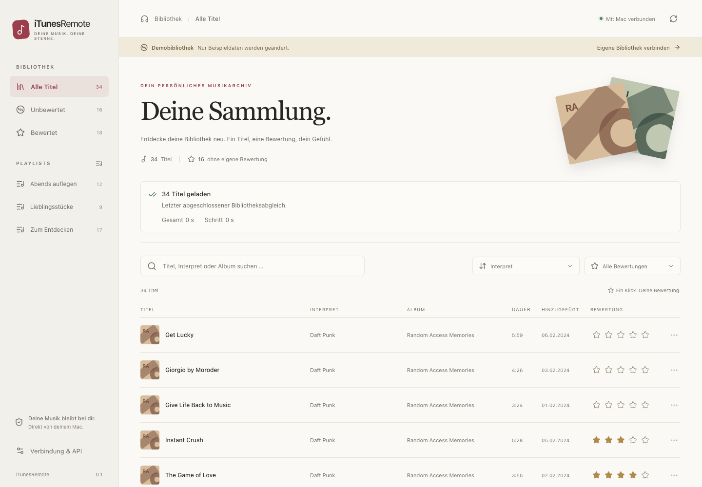
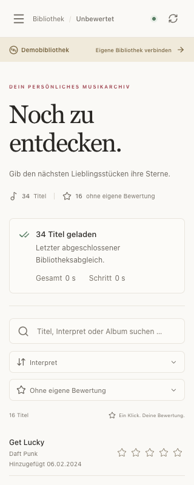

# iTunesRemote

**English** | [Deutsch](README.de.md)

A macOS menu bar app for browsing and rating your Apple Music library from a browser on your Mac or another device on the same local network. Built with **SwiftUI**, a **Python/Starlette** service and a **React/TypeScript** web interface.

The app is intended for personal use. Report problems or suggestions through a [GitHub issue](https://github.com/DWegmann/iTunesRemote/issues). The app interface is currently in German; this repository includes English and German documentation.

> **Noncommercial reuse only:** The original project code may be used, modified and shared under the [PolyForm Noncommercial License 1.0.0](LICENSE.md). This license does not permit commercial use.

The tested standalone build is **0.1.0, build 19**, for **Apple Silicon (arm64), macOS 26.0 or later**. It is signed with Apple Development and **not notarized**. The bundled Python runtime determines that minimum version; the Swift host's macOS 14 target does not establish support for older systems by the complete app.

## Example screenshots

These screenshots show only the built-in demo library in a browser. The narrow view is a responsive web interface, not a native iPad app.





## Features

- Search by title, artist, album and genre; filter by playlist and rating.
- Sort by artist, title, album, rating, duration or date added, with cursor pagination.
- Set one to five stars or remove a personal rating; inherited album ratings remain distinguishable.
- See choices immediately while a persistent queue saves them to Music and verifies each result by reading it back.
- Enter several ratings without waiting. Pending choices for the same track are combined; accepted jobs survive browser closure and service restarts.
- Search the saved library during background imports, with progress and diagnostic information.
- Access the interface over the local network using a persistent web password.
- Use light and dark themes, keyboard controls and layouts for narrow screens.
- Try an isolated demo without reading or changing your personal Music library.
- Use a versioned REST API as the foundation for future native clients.

This version does not play or stream audio. A native iPad app, Bonjour discovery, automatic device pairing and HTTPS are not implemented.

## Origins and license

The original project code is published under the **PolyForm Noncommercial License 1.0.0**, following [Lichtblick](https://github.com/DWegmann/Lichtblick) and [Mac Spaces Wallpaper Manager](https://github.com/DWegmann/MacSpacesWallpaperManager). The complete [license text](LICENSE.md) is authoritative. Redistribution must retain the license text or its URL and the required notices.

Required Notice: Copyright 2026 Dominic Wegmann

This license applies to the original project components to the extent that the relevant rights exist. The source is publicly available for noncommercial reuse ("source available"); the commercial restriction means it is not an OSI open-source license. Third-party components retain their own licenses and independent rights.

The split between iTunesLibrary for reading and ScriptingBridge for writing follows the interface approach of [apple-music-mcp](https://github.com/ravishchawla/apple-music-mcp). This project's implementation was written independently. See [THIRD_PARTY_NOTICES.md](THIRD_PARTY_NOTICES.md) for attribution and dependencies.

## Build from source

The repository contains source code. Local app bundles and ZIP files in `dist/` are excluded from Git.

You need macOS, Apple Command Line Tools with Swift, **Python 3.12 or later**, a Node.js version supported by Vite 8, and npm. The recorded build environment uses Python 3.14.3, Swift 6.4 and Node 23.3.0. Dependencies are pinned in `pyproject.toml`, `requirements-dev.lock` and `web/package-lock.json`.

```sh
git clone https://github.com/DWegmann/iTunesRemote.git
cd iTunesRemote
make setup
make demo
```

`make demo` builds the web interface and opens an isolated demo stored in `.local/demo`. To build the standalone Mac app:

```sh
make build
```

This creates `dist/iTunesRemote.app` and `dist/build-info.json`, bundling Python and the built web interface. App users do not need a separate Python or Node installation.

The build uses a valid signing identity from your own macOS Keychain. With multiple identities, select one explicitly:

```sh
.venv/bin/python scripts/build_app.py --identity 'Apple Development: YOUR NAME (TEAMID)'
```

The first successful certificate-signed build records its public identity and code requirements in the ignored `.local/signing.json`. Later builds require the same identity to preserve the basis for macOS permission continuity. No private signing key is stored in the repository. An explicit `--identity -` allows an ad-hoc test build, without preserving that continuity. Notarization is a separate distribution step.

## Start and connect

1. Open `dist/iTunesRemote.app`. The menu bar app starts its service on fixed port **8765** and opens `http://127.0.0.1:8765/`.
2. Grant **Media & Apple Music** and **Automation for Music** permissions when macOS asks. The startup permission check can be disabled in the Mac app.
3. Show or copy **Webpasswort** in the Mac app and use it to sign in through the browser.
4. Wait for the first import. A previously saved library remains searchable during later imports.
5. Choose a star rating. A pending indicator remains until Music confirms the saved value. Errors and conflicts remain visible.

For another device, keep the Mac awake and the app running, connect both devices to the same network, then copy **Netzwerkadresse** from the Mac app. Open that address and sign in with the same web password. The address contains no credentials.

The service uses **unencrypted HTTP**, including password transmission, and is intended for a trusted local network. It binds to `0.0.0.0` by default; accepted hosts are limited to loopback and private IPv4 interface addresses detected at startup. Restart after a network change. An occupied port produces an error rather than silently changing the address.

To run directly from source against your real library:

```sh
make run
```

To restrict a source-run service to this Mac, after building the web interface:

```sh
PYTHONPATH=backend .venv/bin/python -m itunesremote --host 127.0.0.1 --port 8765 --open-browser
```

`ITUNESREMOTE_PORT` changes the default port; an explicit `--port` takes precedence. Fully quit the menu bar app before replacing a build. Closing its window does not quit it.

## Local data and rating safety

Normal app data lives under `~/Library/Application Support/iTunesRemote`: the renewable library index, `auth.sqlite3`, `rating-queue.sqlite3` and diagnostic logs. Keep this directory when updating to preserve the password, sessions and accepted jobs. A different or deleted data directory gets a new password.

The app generates a persistent 24-character web password. Browser sessions last twelve hours. Authentication data is stored with restricted user permissions; passwords are not included in URLs or diagnostic logs. Browser writes require an allowed origin and CSRF proof. Native device credentials are separate, revocable tokens.

Metadata reads use Apple's iTunesLibrary framework. Rating writes use ScriptingBridge, check library identity and the expected rating revision, then read the result back. The app does not edit Music's private database files. Concurrent changes can cause a conflict; there is no atomic transaction across the two Apple interfaces.

Accepted queue entries continue after the browser closes. Choices not yet accepted by the Mac remain in browser storage and require the same browser address to be reopened. Interrupted writes with an uncertain outcome are not blindly repeated. Imports pause queue processing. There is no bulk-rating or undo feature in this version.

Use **Diagnoseprotokolle öffnen** in the Mac app to open the diagnostic folder. Share sanitized errors rather than passwords, device credentials or personal library data.

## Validation

```sh
make test
make qa
.venv/bin/python scripts/smoke_bundle.py
.venv/bin/python scripts/smoke_import_diagnostics.py
```

`make test` runs Ruff, Python tests and TypeScript checking, including compiled Swift checks when available. `make qa` builds the web interface and runs Playwright using an isolated demo server and Chrome profile. The configured Chrome path is `/Applications/Google Chrome.app/Contents/MacOS/Google Chrome`.

Bundle smoke checks require a built Mac app. Automated checks use temporary demo or simulated data; they do not read or change your personal Music library. Tests cover authentication, origin and CSRF checks, token rotation and revocation, rating readback, conflicts, retries, queue recovery, background imports, LAN access and responsive layouts.

See [PRUEFUNG.md](PRUEFUNG.md) for the dated record and its limits. Personal cloud libraries, real artwork, rating writes to the user's own Music library and access from a separate physical device have not been systematically validated. Some cloud tracks cannot be resolved through ScriptingBridge; these produce an error rather than a reported success.

## API and project structure

Web and future native clients share `/api/v1`. The exported contract is [api/openapi.json](api/openapi.json). Native clients can use device access and refresh tokens without browser cookies. Queue endpoints currently serve the host and authorized browser sessions; bearer-token devices use the synchronous rating endpoint.

| Path | Purpose |
| --- | --- |
| `macos/` | SwiftUI host, menu bar, lifecycle and app metadata |
| `backend/itunesremote/` | Starlette API, SQLite stores, authentication and Music/demo adapters |
| `web/` | React/TypeScript interface, Vite build and Playwright tests |
| `api/openapi.json` | Versioned API contract |
| `scripts/` | Packaging, contract export and smoke checks |
| `tests/` | Python tests and native Swift checks |
| [README.de.md](README.de.md) | Detailed German usage, architecture and API documentation |
| [KONZEPT.md](KONZEPT.md) | Original concept and future work; not a list of delivered features |
| [PRUEFUNG.md](PRUEFUNG.md) | Validation record and outstanding evidence |

When reporting a problem through [GitHub issues](https://github.com/DWegmann/iTunesRemote/issues), include the macOS version, architecture, app build and a sanitized error message.
